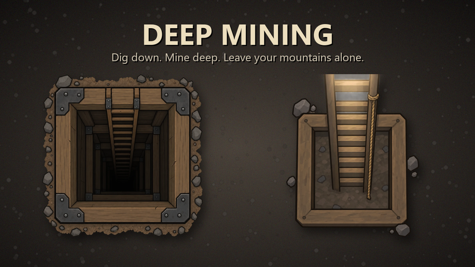

# Yuudong Deep Mining

A RimWorld 1.7 mod that adds mine shafts: dig down into underground levels and mine ore there instead of tearing up the mountains around your base. The underground levels and the surface work together as one colony, without modifying the vanilla AI.



Player-facing documentation (features, settings, design rules): [`YuudongDeepMining/README.md`](YuudongDeepMining/README.md)

This project was built with an AI coding agent (Claude Code) working under my own agent harness toolkit. I defined the goals and the design constraints and did all in-game testing. The agent implemented, verified and debugged the code. The development process is described [below](#how-it-was-built).

## What it does

- **Mine shafts and underground levels.** Each shaft opens a new underground level, which is a vanilla pocket map. Deeper levels have more ore and more valuable ore. Rock gets harder with depth, and infestations come more often.
- **One colony across levels.** Colonists pick work, beds, food and recreation on any level, using vanilla job selection order and walking distance. Items are carried by hand through the ladders. This includes stockpile priorities across levels, bill ingredients, construction materials, and rescuing downed pawns to a bed on another level.
- **Unified colony state.** Resource counts, "do until X" bills, colony wealth, alerts and the bottom pawn tabs cover every level of the shaft chain.
- **Cross-level control.** A draggable level panel lets you view another level while your colonists stay selected. You can right-click there to give orders, and they climb the ladders and carry them out. Colonists can also be selected and drafted across levels at the same time.
- **Smart raids.** Sapper and breacher raids follow your colonists underground when the surface is empty.

## Engineering highlights

- **Ghost evaluation instead of re-implemented AI.** To decide "is there work for this colonist on another level?", the mod briefly treats the pawn (or workbench) as if it stood at that level's ladder. It then runs the *vanilla* decision code — work givers, think-tree nodes, bed search, ingredient search, float menus — and restores the original state in a `finally` block.
  - The RNG state and bill search timers are restored too.
  - All of this lives in one file ([`GhostUtility.cs`](YuudongDeepMining/Source/YuudongDeepMining/Levels/GhostUtility.cs)).
  - Other mods that change vanilla behavior therefore keep working on every level.
- **Design rules enforced by a test harness.** These five rules are written down and checked automatically:
  - Never skip vanilla originals.
  - Swap map and position only in `GhostUtility`.
  - No parallel job queue.
  - Hook common points, not individual features.
  - Leave rendering and pathfinding untouched.
- **Out-of-game verification harness** ([`tools/ydmtest`](tools/ydmtest)). It loads the real game assemblies and applies every Harmony patch class (currently 28 classes on 50 methods). It also checks:
  - patches that call themselves recursively
  - map and position swaps outside `GhostUtility`
  - XML definitions that point to missing fields or C# classes
  - key bindings and transpiler matches
  - the depth tables used in the settings

  Every change is built and run through it before it reaches the game.
- **Built-in profiler.** An optional setting shows this mod's own time per second by category, counting only each category's own share, and logs it every 10 seconds. Caches and a transpiler were added based on its measurements.
- **Compatibility by design.** Examples:
  - Better Workbench Management's "count away pawns" would count colonists on underground levels twice. The fix uses reflection only and does nothing when that mod is absent.
  - On .NET 10 the runtime may inline small methods, which bypasses patches on them. Input hooks are therefore placed at several points of the vanilla input flow.

## How it was built

The workflow is the same as in my other agent projects:

1. **Specify.** I describe the feature or the bug, often with a screenshot or a game log.
2. **Plan.** The agent selects a workflow from my (private) agent harness toolkit (feature development or bug fix). It reads the relevant vanilla code from the decompiled game assemblies and proposes a plan. Nothing is changed until I approve it.
3. **Implement and verify.** The agent edits the code, builds it, and runs the test harness, which must report `failed=0`. It then copies the mod into my local game folder.
4. **Play-test.** I test in the game and report back. The agent separates confirmed facts from hypotheses and says what it could not verify.

Examples of issues found this way:

- **Colonists stuck at a ladder.** The game log showed `KeyNotFoundException: Area_Home` thousands of times. The agent traced it to the cross-level pawn table: it stored one level's allowed area for a pawn on another level, which broke that level's pathfinder. The fix draws the area selector per level and repairs affected saves on load.
- **Bill counts doubled.** Better Workbench's "away pawn" tracking and this mod's level aggregation both counted the same colonists. An early fix targeted the wrong code. It was reverted and replaced with a targeted compatibility hook.
- **Materials going back and forth between levels.** A code review pass found that materials delivered to another level could be hauled straight back. The fix was to claim destination storage cells before a hauler leaves, and to exclude freshly delivered items from cross-level hauling.

The agent instructions for this repository are in [`CLAUDE.md`](CLAUDE.md).

## Repository layout

```text
YuudongDeepMining/          The mod folder (About, Defs, Languages, Textures, Assemblies, Source)
  Source/YuudongDeepMining/
    Levels/                 Cross-level core: ghost evaluation, travel, hauling, bills,
                            rescue, aggregation, remote control, profiler
tools/ydmtest/              Out-of-game test harness (Harmony patch application + rule checks)
tools/ydm_lang.py           Generates English/Korean translation files from one table
art/                        Source images and scripts for the shaft textures
CLAUDE.md                   Instructions for the coding agent
```

## Build

Requirements: the .NET SDK and a RimWorld 1.7 installation (the project references the game assemblies and Harmony).

```bash
cd YuudongDeepMining/Source/YuudongDeepMining
dotnet build -c Release
```

The build writes `YuudongDeepMining/Assemblies/YuudongDeepMining.dll`. To run the harness:

```bash
cd tools/ydmtest
dotnet build -c Release
dotnet bin/Release/net10.0/ydmtest.dll
```

The game path is set by the `RimWorldDir` property in the project files.

## Status

- Personal project, actively play-tested on RimWorld 1.7.
- About 5,600 lines of C#.
- Texture art was generated with an image model and then edited (see `art/`).
- No license is granted; all rights reserved.
